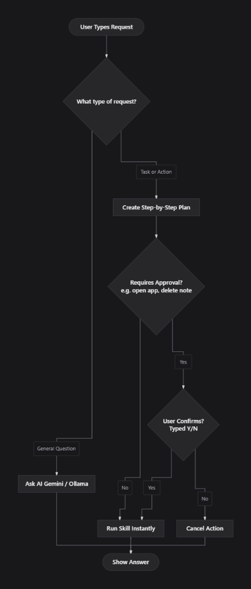
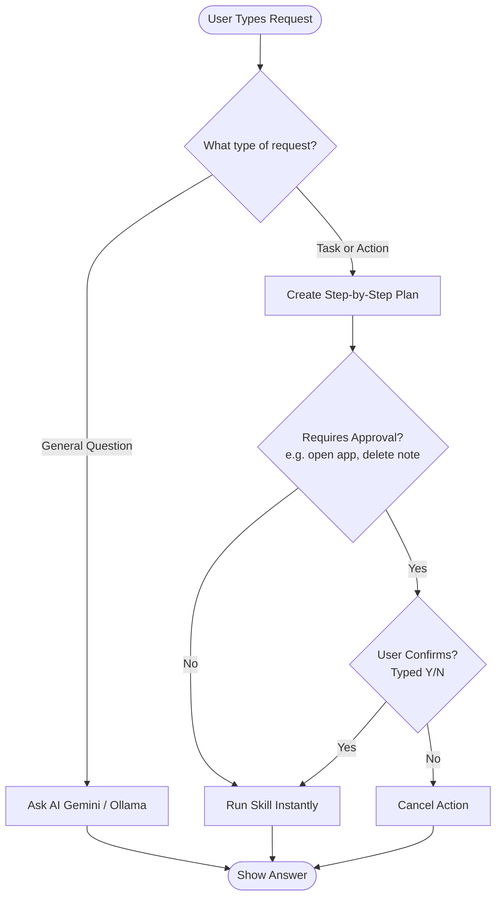
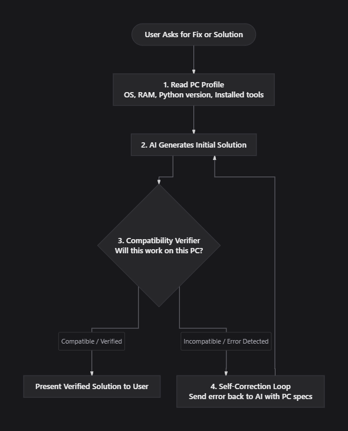
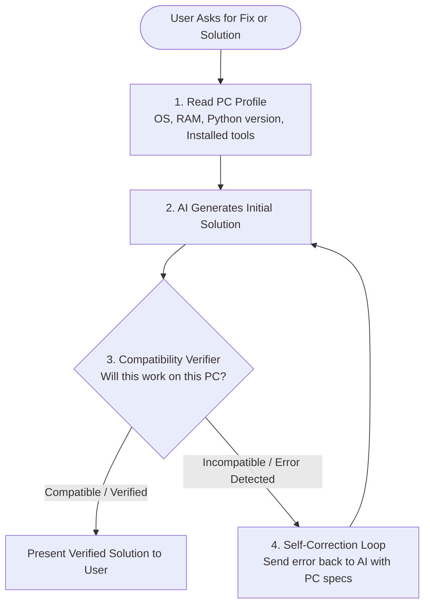

# I.R.I.S Flowcharts

This document contains the two core architectural flowcharts for **I.R.I.S (Iris)**:
1. **Flowchart 1: Core Request Lifecycle & Human-in-the-Loop Safety Flowchart**
2. **Flowchart 2: Device-Aware Compatibility & Self-Correction Loop (Actor-Critic)**

---

## 1. Core Request Lifecycle & Human-in-the-Loop Flowchart

This flowchart shows how Iris processes every user input, routes general questions directly to AI models, creates step-by-step plans for actions, and enforces human permission before any state change.

### Visual Diagram


### Mermaid Flowchart Code


### Text / Slide-Ready Box Diagram
```text
[ User Types Request ]
          │
          ▼
{ What type of request? }
    │
    ├──► General Question ──────► [ Ask AI Gemini / Ollama ] ──────► ( Show Answer )
    │                                                                       ▲
    └──► Task or Action ────────► [ Create Step-by-Step Plan ]              │
                                               │                            │
                                               ▼                            │
                                   { Requires Approval? }                   │
                                        │ (e.g. open app, delete note)      │
                                        ├── No ──► [ Run Skill Instantly ] ─┤
                                        │                                   │
                                        └── Yes ─► { User Confirms? (Y/N) } │
                                                       ├── Yes ─► [ Run Skill Instantly ] ──┘
                                                       └── No  ─► [ Cancel Action ] ────────┘
```

---

## 2. Device-Aware Compatibility & Self-Correction Loop

This flowchart illustrates Iris's pre-flight verification system. Before an AI-generated script or system command is presented to the user, Iris checks it against the actual machine profile (Windows 11, Intel CPU, 32GB RAM, integrated GPU without CUDA). If incompatibilities are detected, the reflection loop automatically prompts the AI to correct it.

### Visual Diagram


### Mermaid Flowchart Code


### Text / Slide-Ready Box Diagram
```text
[ User Asks for Fix or Solution ]
               │
               ▼
[ 1. Read PC Profile ]
(OS, RAM, Python version, Installed tools)
               │
               ▼
┌─────────────►[ 2. AI Generates Initial Solution ]
│                              │
│                              ▼
│              { 3. Compatibility Verifier }
│              (Will this work on this PC?)
│                              │
│       ┌──────────────────────┴──────────────────────┐
│       ▼                                             ▼
│ [Incompatible / Error Detected]            [Compatible / Verified]
│       │                                             │
│       ▼                                             ▼
└─[ 4. Self-Correction Loop ]              [ Present Verified Solution to User ]
  (Send error back to AI with PC specs)
```

---

### Step-by-Step Explanation for Presentations & Viva

#### Flowchart 1: Request Lifecycle
1. **Input:** The user types a natural language instruction or question into the CLI.
2. **Intent Routing (`router.py`):** Iris determines if the request is a simple conversational query or an operational task.
3. **Planning (`task_planner.py`):** Multi-step requests are transformed into an ordered execution plan with dependencies.
4. **Approval Gate (`action_gateway.py`):** If an action modifies system state (file deletion, app launch), Iris prompts the user for typed confirmation (`yes/no`).
5. **Execution (`skills.py`):** Only approved tasks run; rejected tasks halt safely.

#### Flowchart 2: Self-Correction Loop
1. **Context Grounding (`device_profile.py`):** Reads the host PC specifications (Windows 11, 32GB RAM, Intel Iris Xe, PowerShell).
2. **Generation (`ai.py`):** The LLM proposes a technical resolution.
3. **Pre-Flight Validation (`solution_verifier.py`):** Deterministic checks ensure commands don't use Linux syntax (`sudo`, `apt`) or require non-existent hardware (`CUDA`).
4. **Reflection Feedback:** Incompatibilities are fed back to the model with target constraints to regenerate a 100% working solution.
