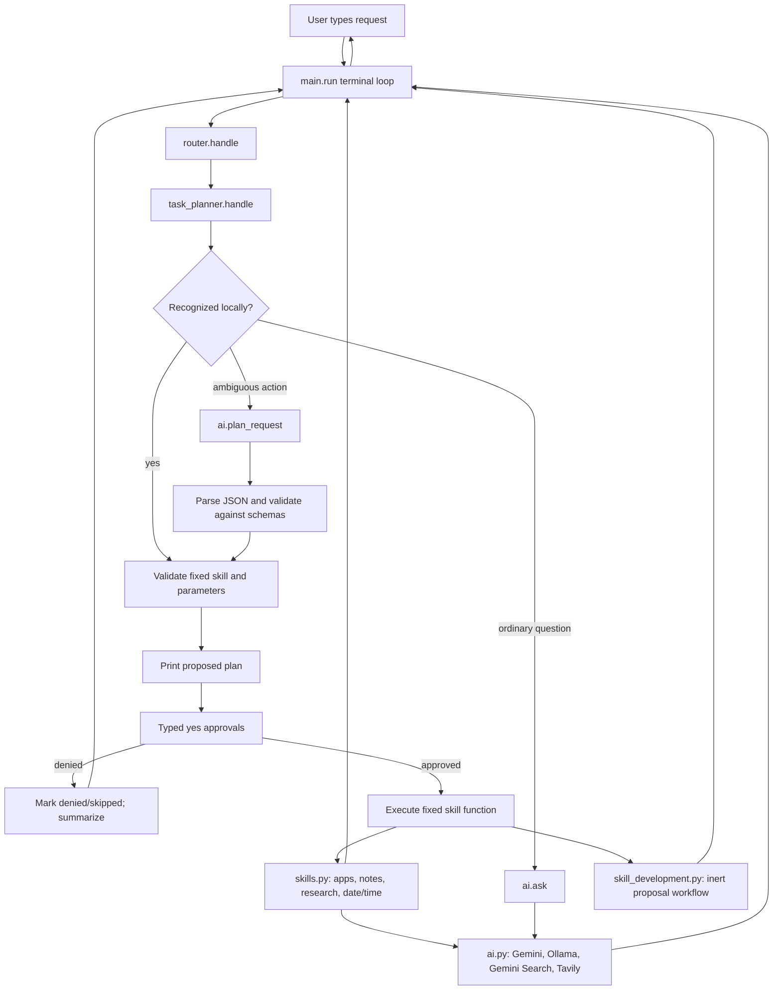

# 01 — Architecture and data flow

## Diagram

## The request path

1. `main.run()` prints a greeting and reads one line with `input()`.
2. `router.handle()` delegates to `task_planner.handle()`. The old private routing helpers in `router.py` remain in the file, but the public `handle` path does not use them.
3. `task_planner._deterministic_plan()` tries known phrases first. If it cannot parse an action-like request, `ai.plan_request()` may return a JSON proposal.
4. `validate_plan()` and `_validate_step()` reject unknown skills, malformed fields, invalid parameters, bad target names, and invalid dependencies.
5. `_describe_plan()` prints the plan. `_execute()` gathers required approvals before running any step that has a permission requirement.
6. `_run_step()` uses explicit `if` branches to call known functions in `skills.py`, `skill_development.py`, or `ai.py`.
7. `main.run()` prints and logs only a generic outcome label. It does not log user text.

## Module map

### `main.py` — application entry point

Starts logging and the read/answer loop. It imports `router`, catches input termination and unexpected request errors, prints the response, and stops on exit words. If removed, no normal terminal application loop starts.

### `router.py` — public routing facade

The current `handle()` is a thin wrapper to the planner. Other private helper functions implement older direct routing logic, but they are not called by the public function. `normalize()` is still called by `main.run()` to recognize exit commands after handling. If removed without changing imports/callers, the application fails at startup or request routing.

### `task_planner.py` — parse, validate, approve, execute

Defines allowed skills and parameter schemas; creates a `PlanStep` dataclass; parses known commands; asks AI for constrained JSON only when needed; validates plans; previews, collects approval, executes, and summarizes results. This is the control center for action safety.

### `skills.py` — concrete capabilities

Implements date/time, help, allowlisted app/site opening, notes, and delegates web research to `ai.research_web`. It performs file-system validation and JSON note storage. If removed, validated plans have no concrete implementations to call.

### `ai.py` — provider boundary

Owns chat history, `.env` key loading (without exposing values), Gemini/Ollama chat and planning HTTP requests, research requests/formatting, and AI-generated proposal text. It returns strings or raises controlled exceptions; it does not directly execute a plan.

### `skill_development.py` — inert skill proposal workflow

Checks metadata and generated source through Python's AST, prints it for review, asks typed approval to save an inert JSON record, and appends audit events. It never imports or runs proposal source and never makes a proposal active.

### `config.py` — settings

Defines project/data/log paths, selected model/provider defaults, Ollama loopback URL, and allowlists. It contains no API key. Wrong app paths or model names can cause runtime failures, even though code structure remains valid.

### Tests

Eight `tests/test_*.py` files exercise isolated behaviors. They use `unittest`, `unittest.mock`, and temporary folders. Tests are not imported by the production entry point.

## Important Python terms

- **Module:** one Python `.py` file, such as `skills.py`.
- **Package:** a directory Python can import as a grouped unit; this checkout's application code is mostly flat modules. `tests` is a test directory.
- **Function:** reusable named work, declared with `def`.
- **Class:** a type definition. `PlanStep` is a dataclass-generated class.
- **Object:** a particular value, such as a `PlanStep` instance.
- **Variable:** a name referring to a value, such as `command`.
- **Configuration value:** a setting intended to control behavior, such as `AI_PROVIDER`.
- **API:** a defined way for programs to exchange requests and responses. Gemini and Tavily expose web APIs; Iris uses HTTP.

## Failure boundaries

If the AI is down, ordinary chat and AI-assisted planning fail, but deterministic date/time/notes can still work. If a search service is down or quota-blocked, research returns an error and should not invent results. If logging fails, `setup_logging()` falls back to critical-only logging. If note JSON is malformed, Iris reports the issue and leaves the file intact. If a skill raises an unexpected exception, planner execution marks that step failed and reports a sanitized error description.

### Recap

The terminal loop receives text; the planner validates and gates actions; skills do the actions; `ai.py` talks to services; config supplies fixed settings.

### Check yourself

1. Which function is the current public request path?
2. Does `router._single_command()` handle current public requests?
3. What prevents a model from inventing a new action?
4. Which module opens apps?
5. Which module stores proposals?

**Answers:** 1. `task_planner.handle()` via `router.handle()`. 2. No. 3. Fixed schemas plus validation and explicit dispatch. 4. `skills.py`. 5. `skill_development.py`.
