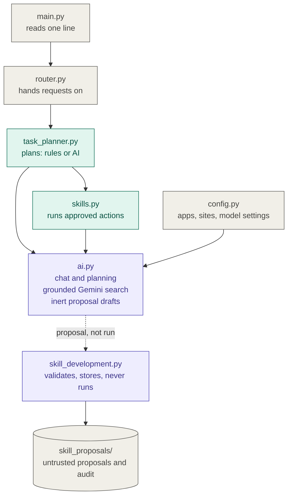

# Architecture

## Diagram as Mermaid (GitHub draws this automatically)

## What each part does

| File | Job |
|---|---|
| `main.py` | Reads one line of input |
| `router.py` | Hands each request to the task planner |
| `task_planner.py` | Makes a deterministic plan, or asks the AI for a constrained proposal |
| `skills.py` | Performs approved actions, manages notes, and starts bounded research |
| `ai.py` | Chat, planning, grounded Gemini search, and inert proposal generation |
| `skill_development.py` | Validates and stores proposals without running them |
| `skill_proposals/` | Untrusted proposal and audit folder, created when needed |
| `config.py` | App, website, and model settings |
| `tests/` | Mock the AI, web responses, and app launches; no live web requests |

## Assumptions in the diagram (check these)
- `ai.py` passes drafted proposals to `skill_development.py`.
- `config.py` also feeds `skills.py` (apps and websites); only one arrow is drawn to keep the diagram clear.
- `tests/` is not drawn because it takes no part in the runtime flow.
